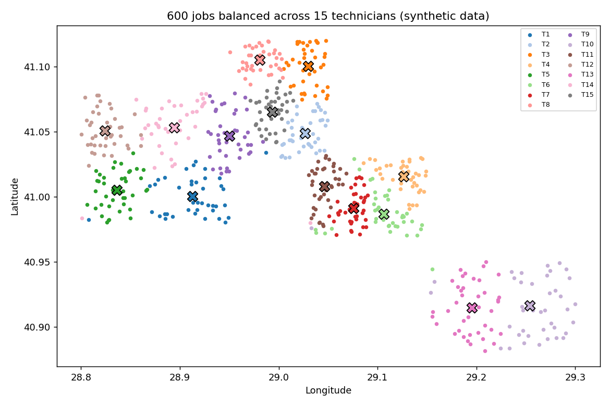

# Field Service Territory Balancing

Assigns maintenance jobs to field technicians so that **every technician gets the same workload** and a **compact area** to cover.



## Background

In 2025 I worked on this problem at **Optima Engineering** in Istanbul. Building maintenance and repair requests were assigned to technicians by hand from an Excel export. The project had three planned phases:

1. **Location data:** clean the request data and geocode every site (Python + Google Places API).
2. **Assignment and routing:** split jobs fairly between technicians, then optimize routes.
3. **Tool for the operations team:** a simple interface showing the plan on a map.

I built phase 1 and the first version of phase 2: a balanced territory model with map visualizations.
This repository is a cleaned-up version of that model. **All data here is synthetic.** The real customer sites and requests are not included.

## How it works

1. Generate 600 synthetic jobs across Istanbul's districts, each with a priority and duration.
2. Start 15 technician territories at random job locations.
3. Repeat until stable:
   - assign each job to the nearest territory that still has room (max `ceil(600 / 15) = 40` jobs each),
   - move each territory center to the mean of its jobs.

This is K-Means with a capacity limit, so territories stay compact while workloads stay equal.

## Run

```bash
pip install -r requirements.txt
python balance.py
```

Outputs in `output/`:

- `assignments.csv` lists every job with its technician.
- `territories.png` is the static chart above.
- `territories_map.html` is an interactive map (folium).

## Next steps (not built)

- Balance by **hours** instead of job count, and respect priorities and deadlines.
- Real road distances (OSRM or Google Directions) instead of straight-line distance.
- Daily route optimization per technician with Google OR-Tools.

## Stack

Python, pandas, NumPy, SciPy, matplotlib, folium
